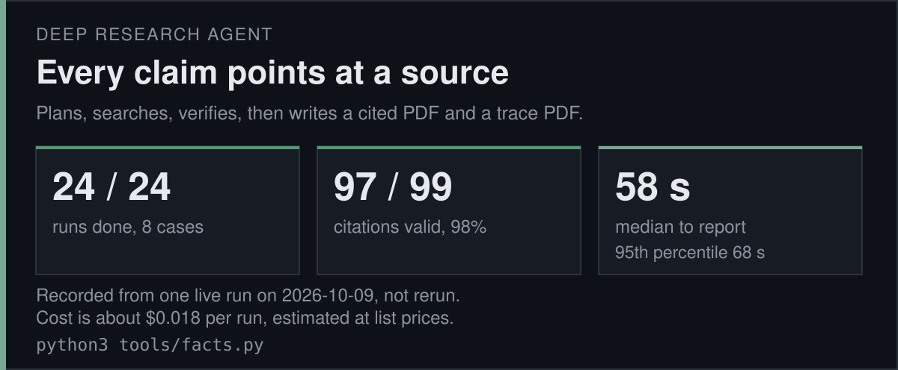
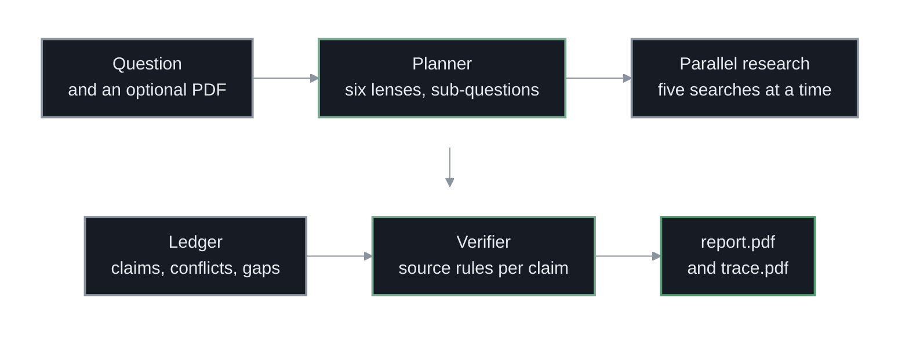
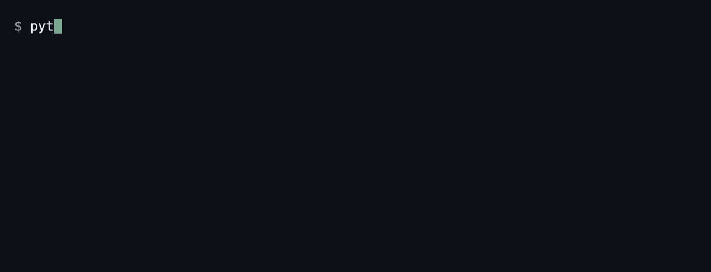
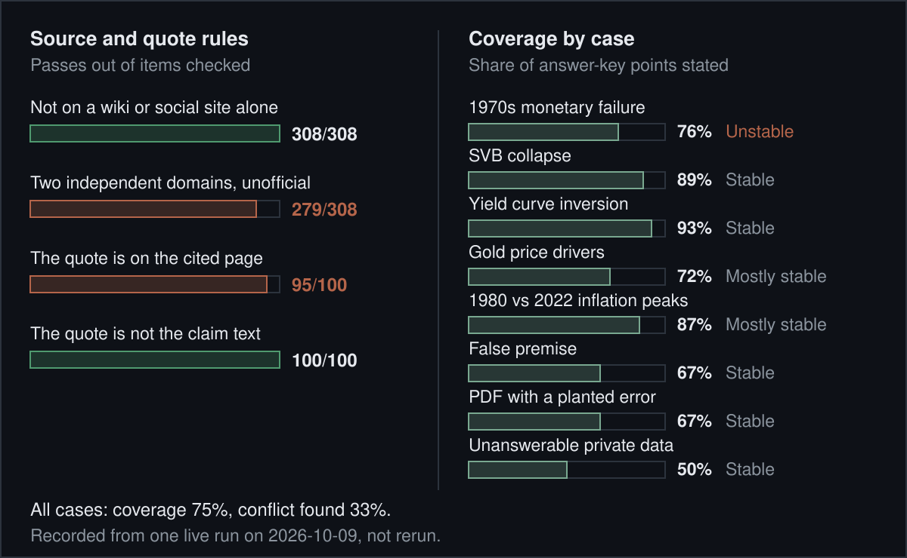
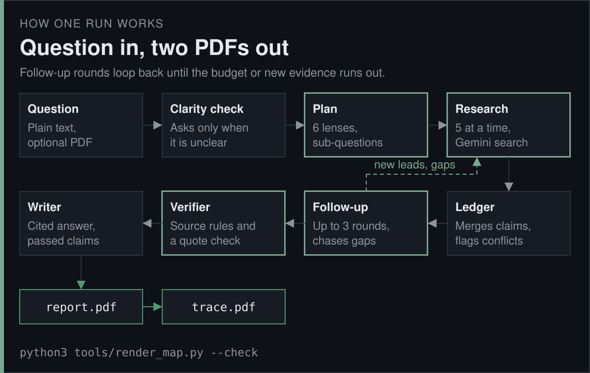

<p align="center">
<a href="https://github.com/jameswniu/fact-verified-llm-research-agents/actions/workflows/gates.yml"></a>


</p>

<p align="center"><code>question -> plan -> research -> verify -> report</code></p>

This is a research agent for finance and economics questions. You type a question, and it writes a PDF report in which every claim links to a source, plus a second PDF that traces every step it took. It talks to the Gemini Developer API with an API key.

The idea is that a claim must earn its place. A verifier checks each claim against its sources by written rules. An official source (a government or university site) counts alone, any other source needs two independent websites, and some sites never count. Claims are marked supported, contested or unsupported, and what the agent could not establish is listed in the report.

The numbers on this page come from one live run of the agent's own eval suite on 2026-10-09. An eval is a fixed set of questions with scoring rules. That run was not repeated, and `tools/check_readme.py` fails if a number here stops matching the saved result files.





## Results



- **Runs:** All 24 runs finished, 3 runs for each of 8 questions. The median took 58 seconds from question to report, and the slowest 5 percent took 68 seconds or more.
- **Citations:** 97 of 99 checked citations were valid, which is 98%. A citation is valid when its quote appears on the cited page.
- **Source rules:** The "never wiki or social alone" rule held 308 of 308 times. The two-independent-sites rule held 279 of 308, and the quote-on-page rule 95 of 100. Those two are drawn in rust because they are not perfect.
- **Coverage:** An answer covered 75% of the points its answer key lists, from 50% on the unanswerable-data question to 93% on yield curve inversion. Where the sources disagree on purpose, a conflict was found in 33% of cases on average.
- **Cost:** About $0.018 per run. This is an estimate from token counts at Gemini Flash list prices, not a bill.



## What this page cannot show you

- **One run:** Every number was recorded from a single live run on 2026-10-09 and was not repeated. Live search results change daily, so a new run gives similar and not identical numbers.
- **Sample size:** 8 questions with 3 runs each. Per-question figures rest on three runs, and one question was labelled unstable across them.
- **Model alias:** The agent uses a `-latest` Gemini model name, which can point to a newer model later.
- **Unchecked links:** 463 citations are links whose page could not be opened, so no quote was checked for them. [FAILURES.md](FAILURES.md) lists the known gaps.
- **Scoring gaps:** A citation counts as valid when its quote is in the stored search snippet, even if the live page no longer shows it. Coverage counts a point found in the agent's claim list as well as in the answer text.
- **The page check:** `tools/check_readme.py` compares the numbers here with the saved result files. It cannot judge whether a sentence describes them fairly.
- **The sample:** [the sample report](samples/demo_run/report.pdf) and [its trace](samples/demo_run/trace.pdf) come from a real run on 2026-10-09 with 151 sources, re-rendered with the current report code. The run itself is older than two later fixes. Its bottom line still says "proved incorrect" over a disputed point, and it cites a Scribd upload that the current rules no longer count as support.

## Quick start

```bash
git clone https://github.com/jameswniu/fact-verified-llm-research-agents.git && cd fact-verified-llm-research-agents
python3 -m venv .venv && .venv/bin/pip install -r requirements.txt
env -u GEMINI_API_KEY .venv/bin/python -m unittest discover -s tests -t .
T=$(mktemp -d) && RESEARCH_RUNS_DIR=$T/runs .venv/bin/python samples/fake_run.py $T/report.pdf
T=$(mktemp -d) && RESEARCH_RUNS_DIR=$T/runs .venv/bin/python -m research eval run --fake --repeats 1 --workers 1 --no-url-check --out $T/evals
```

> Needs Python 3.11 or newer. No key is used. The tests take about 30 seconds, and the other two commands take a few seconds each and write only to a temporary folder. The fake run builds a report from invented data, and the fake eval is a smoke test whose numbers mean nothing.

## Point it at your own question

Export a Gemini Developer API key (`export GEMINI_API_KEY="<your key>"`), then run `./research-agent` and type a question at the prompt. You can also hand it a PDF to read alongside the question. The reports land in `runs/<run id>/`. [docs/run.md](docs/run.md) covers the one-shot command line, the live log window, and every setting.

## What ships and what stays private

- **Ships:** The code, the eval cases, the recorded results and the sample run are all here.
- **Stays out:** The API key is never stored in the repo, and the `.env` file and the `runs/` folder are ignored by git.
- **A real run:** It costs a few cents and makes live calls to the Gemini API.

## Files

| Path | What it holds |
|---|---|
| `research/` | The agent, the chat, the command line, the claim store and the PDF report code. |
| `evals/` | The eval cases, scoring rules, the fake agent and the recorded results in `evals/results/`. |
| `tests/` | Unit tests that run with no key, plus break-it tests that need one. |
| `samples/` | The recorded demo run's two PDFs and a script that builds a report from invented data. |
| `tools/` | The figure generators, `facts.py` that computes every number here, and the README checker. |
| [ARCHITECTURE.md](ARCHITECTURE.md) | Which file does each step, and the design in detail. |
| [DECISIONS.md](DECISIONS.md) | Tradeoffs and what was left out. |
| [docs/evaluation.md](docs/evaluation.md) | The eval set, scoring and the full recorded tables. |
| [docs/roadmap.md](docs/roadmap.md) | Work that is not built yet. |

## License

MIT, see [LICENSE](LICENSE).
